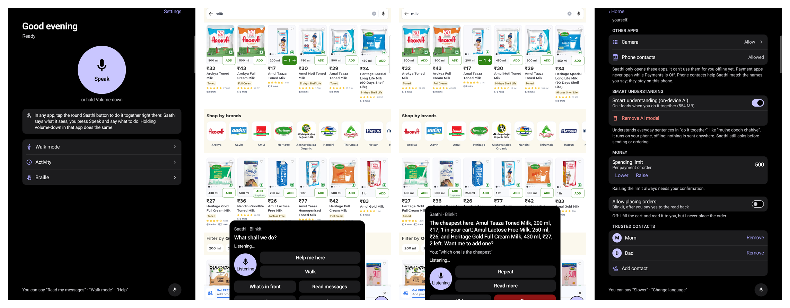
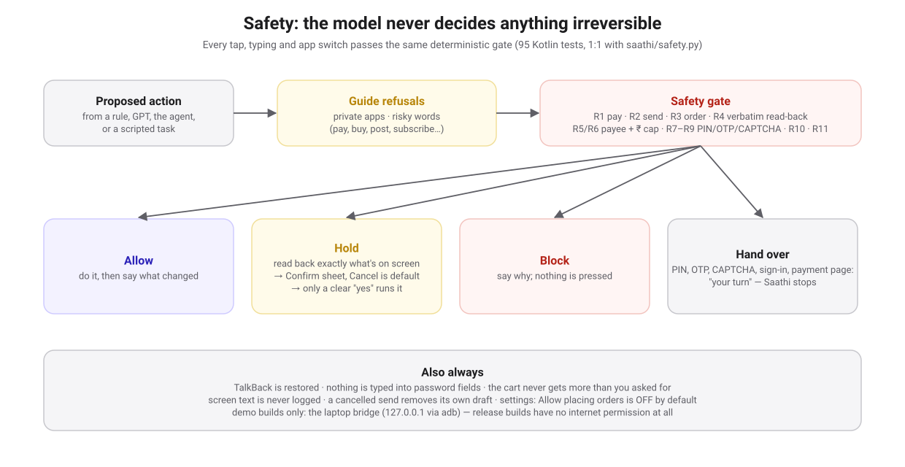
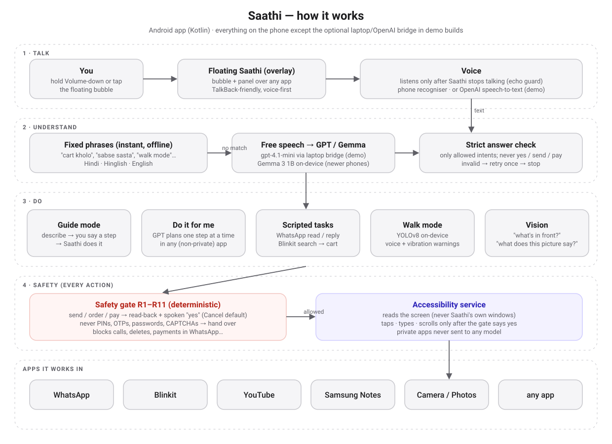
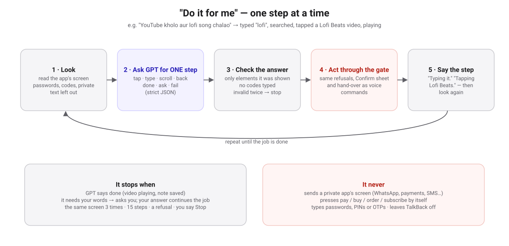

# Saathi

**A voice-first assistant that lets blind and low-vision people use any Android app by talking: in Hindi, English or Hinglish, with a hard safety layer so it never sends, orders or pays without a clear "yes".**

Tap the floating Saathi bubble (or hold Volume-down) in any app and talk:

> *"is app mein meri help karo"* → Saathi describes the screen, then does each step you say.
> *"sabse sasta kaun sa hai"* → "The cheapest here: Amul Taaza Toned Milk, 200 ml, ₹17…"
> *"YouTube kholo aur lofi song chalao"* → it opens YouTube, searches and plays one, saying each step.
> *"Mummy ko message karo: main 7 baje aaunga"* → it types it, reads back who and what, and sends only after *"haan"*.
> *"walk mode"* → the camera watches the way and warns you by voice and vibration.

Built for **HACK47: OFFGRID** (October 2026).



*Left to right: Saathi's home screen · the bubble's "What shall we do?" panel over Blinkit · guide mode answering "which one is the cheapest" · Settings ("Allow placing orders" is off by default).*

---

## What it does

| You say (any mix of Hindi / English) | What Saathi does |
|---|---|
| Tap the bubble / hold Volume-down | A panel opens over the app you're in: *"What shall we do?"* — Help me here · Walk · What's in front · Read messages |
| "help me here", "is app mein meri help karo" | **Guide mode**: reads the screen (exact labels, prices, cart), then does each step you say — search, add, open cart, scroll, go back |
| "YouTube kholo aur lofi song chalao", "Samsung Notes mein note likho: kal doodh lena hai" | **Do it for me**: GPT plans one step at a time in the app, every step through the safety gate; it says each step and stops when done |
| "Mummy ka last message padho", "kiske message aaye hain?" | Reads WhatsApp messages and unread senders, word for word |
| "Mummy ko message karo: …" | Types the message, reads back recipient + exact text from the screen, sends only on a clear "yes" (Cancel is the default) |
| "mujhe doodh chahiye", "sabse sasta kaun sa hai", "checkout karo" | Blinkit shopping up to the payment page — then **"your turn"**: Saathi never pays |
| "walk mode" | On-device obstacle warnings (YOLOv8) by voice + vibration, from the bubble over any app |
| "what's in front of me", "what does this picture say" | Describes the camera view or the pictures on screen (vision model) |
| — | Braille reader, TalkBack-friendly Clarity design, Hindi/English voice, Settings for every permission |

Tested on a Samsung Galaxy Tab S6 Lite (Android 13). See [`PROJECT.md`](PROJECT.md) for the dated decision log and what was measured.

---

## Safety: the model never decides anything irreversible



Every tap, typing and app switch — from a fixed phrase, GPT, the agent or a scripted task — passes the same **deterministic safety gate** ([`android/safety`](android/safety), a 1:1 port of [`saathi/safety.py`](saathi/safety.py); 95 Kotlin + 187 Python tests):

- **Send / order / pay** → read-back of exactly what's on screen → Confirm sheet with **Cancel as the default** → only a clear spoken "yes" runs it. Unclear → ask once more → cancel.
- **Never** types or reads PINs, OTPs or passwords; **never** solves CAPTCHAs; PIN, sign-in and payment pages → **hand over** to the user.
- Blocks calls, deleting, logging out and payments in WhatsApp; risky buttons (pay, buy, post, subscribe…) are never pressed by the agent.
- "Allow placing orders" is **off** by default; a spending limit applies; the cart never gets more than you asked for.
- TalkBack is always restored; Saathi never reads its own windows; screen text is never logged.

---

## How it works



**"Do it for me"** — a small planner, not an autonomous agent: one step at a time, each one checked and gated.



- **Android app** (Kotlin, Jetpack Compose) — [`android/`](android): an AccessibilityService reads the screen and acts; the floating bubble and panel are accessibility overlays (no "draw over apps" permission).
- **Understanding** — fixed phrases first (instant, offline), then a model for free speech: **GPT** (gpt-4.1-mini) through a laptop bridge in demo builds, or **Gemma 3 1B** on-device ([MediaPipe](https://ai.google.dev/edge/mediapipe)) on phones fast enough for it. Every model answer is validated; invalid → retry once → stop.
- **Voice** — the phone's speech recogniser, or OpenAI speech-to-text through the bridge (much better for Hinglish); Saathi never listens while it is talking (echo guard).
- **Vision** — on-device YOLOv8 for walk mode and object lists; a vision model (gpt-4.1-mini) for scene / picture descriptions in demo builds.

### Privacy

- **Release builds have no internet permission at all.** Everything runs on the phone.
- **Demo builds** may use the owner's laptop (Ollama models, or OpenAI with a key kept in the laptop's `.env`) through `adb reverse` to `127.0.0.1` only.
- **Private apps never reach any model:** WhatsApp, payment apps, SMS, email, phone, contacts, Settings — those use the built-in offline flows only.

---

## Run it

### Android app

Requirements: JDK 17, Android SDK (compileSdk 35), an Android 8+ phone with Developer options and wireless debugging.

```bash
cd android
export JAVA_HOME=/opt/homebrew/opt/openjdk@17          # or your JDK 17
./gradlew :safety:test :agent:test :app:assembleDebug   # 95 + 506 tests
adb install -r app/build/outputs/apk/debug/app-debug.apk
```

On the phone: open Saathi → allow the microphone → **Settings → Accessibility → Installed apps → Saathi → On**. The bubble appears over other apps.

Optional, for the demo build's smarter understanding and vision (run on the laptop the phone is connected to):

```bash
scripts/laptop_brain.sh                     # local Ollama models (qwen3:4b, qwen3-vl:2b)
uv run python scripts/openai_bridge.py      # or: OpenAI (OPENAI_API_KEY in .env, never in code)
```

Optional on-device model: copy a Gemma 3 1B `.task` file to `Android/data/app.saathi/files/models/` (see [`ANDROID_APP.md`](ANDROID_APP.md)).

### Laptop prototype (the first version)

The original prototype runs the agent in Python on a laptop and controls a phone over ADB via [Mobilerun](https://github.com/droidrun/mobilerun), with Sarvam speech and OpenAI. See [`SYSTEM_DESIGN.md`](SYSTEM_DESIGN.md).

```bash
uv sync
uv run pytest -q                            # 187 tests
uv run python -m saathi.main --text "WhatsApp kholo aur Mummy ka last message padho"
```

`.env` keys: `OPENAI_API_KEY`, `OPENAI_MODEL`, `SARVAM_API_KEY`, `ADB_SERIAL`, `MAX_AMOUNT_INR` (10), `ALLOW_ORDERS` (false).

---

## Repository

| Path | What |
|---|---|
| [`android/`](android) | The Android app: `app` (screens, voice, overlay, accessibility service), `agent` (guide, flows, planner), `safety` (the gate), `braille` |
| [`saathi/`](saathi) · [`tests/`](tests) · [`eval/`](eval) | The laptop prototype, its tests and on-device evaluation |
| [`walk/`](walk) | Walk mode for the web (on-device YOLOv8 in the browser) |
| [`scripts/`](scripts) | Laptop bridge (Ollama / OpenAI), demo recorder, device utilities |
| [`site/`](site) | Project website and screen prototypes |
| [`docs/images/`](docs/images) | Diagrams and screenshots |
| [`PRD.md`](PRD.md) · [`SYSTEM_DESIGN.md`](SYSTEM_DESIGN.md) · [`ANDROID_APP.md`](ANDROID_APP.md) · [`DESIGN.md`](DESIGN.md) · [`SCOPE.md`](SCOPE.md) · [`PROJECT.md`](PROJECT.md) | Product, architecture, Android plan, design system, scope, decision log |

---

## Status and honest limits

- Built and tested by the team on one tablet; **no blind user study yet**.
- Payments are never automated; Blinkit stops at the payment page by design.
- On the Tab S6 Lite, on-device Gemma 3 1B takes ~22 s per answer, so Saathi marks it "too slow" and uses its rules; the demo uses the laptop bridge instead.
- The "do it for me" planner can make mistakes; it stops when stuck, after 15 steps, or when you say stop, and it can't press risky buttons.
- In a noisy room, "Listen after Saathi speaks" may hear other people — turn it off and use the Speak button.

---

## Licences

Saathi is released under the **GNU AGPL-3.0** ([`LICENSE`](LICENSE)), because walk mode uses YOLOv8 weights by Ultralytics (AGPL-3.0).
Also used: ONNX Runtime (MIT), MediaPipe LLM Inference (Apache-2.0), CameraX / Jetpack (Apache-2.0), Mobilerun (MIT), Sarvam AI and OpenAI APIs (prototype / demo builds), Pexels stock photos on the website (credited there).
