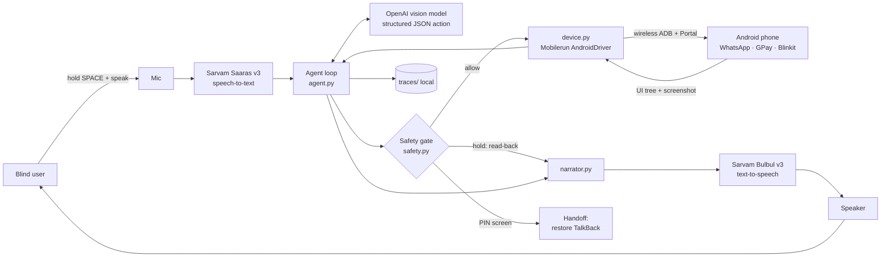

# Saathi — System Design

**Version:** 0.1 · **Date:** 12 Oct 2026 · Companion to `PRD.md`

---

## 1. Overview and constraints

- **Prototype topology:** the laptop is the brain; the Android phone is controlled over wireless ADB through Mobilerun's Portal app. Voice I/O happens on the laptop (mic + speaker / earbuds).
- **Android only.** iOS doesn't allow third-party apps to operate other apps.
- **Own agent loop.** We use Mobilerun only as the low-level device driver (`AndroidDriver`), not its built-in agent, because the safety gate must inspect every action before it executes.
- **Latency budget per step:** observe ≤ 1 s · model ≤ 3 s · act ≤ 0.5 s → ~4–5 s/step. A 10-step flow ≈ 45 s. Narration ensures silence never exceeds ~5 s.

---

## 2. Architecture



---

## 3. Components

| Module | Responsibility | Key deps |
|--------|----------------|----------|
| `main.py` | Entry point. `--text "cmd"` mode for dev; default voice mode | argparse, asyncio |
| `config.py` | Load `.env`, typed settings | pydantic-settings |
| `voice.py` | Push-to-talk recording, STT, TTS, playback, phrase cache | sounddevice, pynput, httpx / sarvamai |
| `device.py` | Wrap `AndroidDriver`; normalize UI tree → element list; screenshots; execute actions; detect screen change; foreground package | mobilerun-core-local |
| `agent.py` | Observe → decide → gate → act loop; history; retries; step limits | openai |
| `actions.py` | Pydantic action schema + validation | pydantic v2 |
| `safety.py` | Deterministic rules: holds, blocks, read-back construction, PIN detection, caps | rapidfuzz, re |
| `narrator.py` | Short Hindi lines, rate limiting, interrupt handling | — |
| `talkback.py` | Suspend / restore TalkBack via ADB settings; always restore on exit | subprocess (adb) |
| `trace.py` | Per-step JSON + PNG logging under `traces/<run_id>/` | — |
| `prompts/` | System prompt + per-app "cards" (hints for WhatsApp, GPay, Blinkit) | — |
| `eval/run_flows.py` | Run flows N times, write success table | pyyaml |

---

## 4. Main loop

```python
async def run_command(cmd: str) -> Result:
    ctx = CommandContext.from_utterance(cmd)  # spoken payee/amount/recipient extracted up front
    await talkback.suspend()
    try:
        history = []
        failures = 0
        for step in range(MAX_STEPS):  # 25
            if controls.interrupted():
                return await halt("Ruk gaya. Aap aage khud kar sakte hain.")

            state = await device.observe(vision=needs_vision(state_prev, history))
            if safety.is_pin_screen(state):
                return await handoff_pin()

            decision = await llm.decide(cmd, state, history, app_card(state.package))
            if decision.say:
                narrator.say(decision.say)

            verdict = safety.check(decision.action, state, ctx)
            if verdict.kind == "block":
                narrator.say(verdict.message)
                return await ask_or_abort(verdict)
            if verdict.kind == "hold":
                if not await confirm(verdict.readback):  # spoken yes / no / unclear
                    return await halt("Cancel kar diya.")

            ok = await device.execute(decision.action, state)
            changed = await device.wait_for_change(state.hash, timeout_s=3)
            trace.log(step, state, decision, verdict, ok, changed)

            failures = 0 if (ok and changed) else failures + 1
            if failures >= 3:
                return await halt("Yeh step nahi ho pa raha. Main ruk raha hoon.")
            if decision.action.type in ("done", "fail"):
                return finish(decision)
            history.append(summarize(decision, ok, changed))
        return await halt("Bahut steps ho gaye, main ruk raha hoon.")
    finally:
        await talkback.restore()  # ALWAYS, including crashes
```

---

## 5. Perception

**UI tree → element list**

- `AndroidDriver.get_ui_tree()` returns the accessibility tree plus phone state. **Its exact dict shape is unverified** — the first build task is to dump it to JSON on a real screen and write the normalizer against it.
- Normalize to:

```python
class Element(BaseModel):
    index: int
    cls: str  # "Button", "EditText", "TextView", ...
    text: str
    desc: str  # content-description
    rid: str  # short resource-id
    clickable: bool
    editable: bool
    password: bool
    bounds: tuple[int, int, int, int]
    center: tuple[int, int]
```

- Filter out invisible and empty non-clickable nodes. Cap at ~150 elements.
- Serialize one per line for the model: `[12] Button "Pay" desc="" rid=pay_btn (540,1820)`

**Screenshot policy** — attach a screenshot (resized ≤ 1080 px wide, JPEG) only when:
- fewer than 5 labeled clickable elements (unlabeled UI), or
- the previous action didn't change the screen, or
- the app is in `VISION_APPS` (config), or
- the model requested `look` last step.

**Screen hash:** hash of `(package, sorted visible texts)` — used to detect whether an action had an effect.

**Foreground package:** from the tree's phone state if present; fallback `adb shell dumpsys window | grep mCurrentFocus`.

---

## 6. Safety gate (deterministic — `safety.py`)

The gate runs on **every** action before execution. It returns `allow`, `hold(readback)` or `block(message)`. No LLM involvement.

| Rule | Trigger | Behavior |
|------|---------|----------|
| R1 Payment hold | Foreground package ∈ `PAYMENT_APPS` and action is `tap` on an element matching `PAY_REGEX` | Hold → read-back of payee + handle/last digits + amount → explicit yes required |
| R2 Message hold | `com.whatsapp` and tap on the send button | Hold → read-back of recipient + message text |
| R3 Order hold | Blinkit and tap on "Place order" / "Pay" | Hold → read-back of item count + total |
| R4 Read-back grounding | Any hold | Every string in the read-back must appear verbatim in the current tree; otherwise block and ask |
| R5 Payee match | R1 / R2 | Fuzzy match (rapidfuzz token ratio ≥ 80) between spoken name and on-screen name; else ask |
| R6 Amount cap | R1 | Parsed on-screen amount ≤ `MAX_AMOUNT_INR`; else block |
| R7 Secret fields | `type` action into an element with `password=true`, or into a field labeled PIN / OTP / password / पिन | Block |
| R8 PIN screen | Tree contains `UPI PIN` / `Enter PIN` / `पिन`, or screenshot ≥ 95% black (secure screen) | Stop all actions → handoff |
| R9 CAPTCHA | Tree/screenshot indicates CAPTCHA | Stop → handoff |
| R10 Risky misc | Tap on delete / uninstall / logout / settings changes not part of the command | Block → ask |

**Config lists (extend as needed):**

```python
PAYMENT_APPS = {
    "com.google.android.apps.nbu.paisa.user",  # Google Pay (India)
    "com.phonepe.app",  # PhonePe
    "net.one97.paytm",  # Paytm
    "in.org.npci.upiapp",  # BHIM
}
PAY_REGEX = r"(?i)\b(pay|send|proceed|confirm|place order)\b|भेजें|पे करें|भुगतान|₹"
YES = {"haan", "haa", "ha", "yes", "confirm", "kar do", "bhej do", "हाँ", "हां", "ठीक है"}
NO = {"nahi", "na", "no", "cancel", "ruko", "mat", "नहीं", "रुको"}
```

**Confirmation default is cancel.** Unclear answer → ask once more → still unclear → cancel.

Every rule gets unit tests using fixture element lists in `tests/fixtures/` (recorded from real screens with `device.dump_fixture()`).

---

## 7. Model contract

**Input** (each step): system prompt (role, rules, Hindi narration style) + app card for the foreground app + the user's command + last 6 history items + element list + optional screenshot.

**Output** — strict JSON, validated with pydantic. Invalid output → retry once → `fail`.

```json
{
  "thought": "Search bar is element 4; I need to type the contact name.",
  "say": "राहुल को ढूंढ रहा हूँ",
  "action": { "type": "tap", "index": 4 }
}
```

| `action.type` | Fields | Notes |
|---------------|--------|-------|
| `tap` | `index` | Executed at the element's center |
| `type` | `text`, `index?` | Taps the field first if `index` given; Unicode via Portal keyboard |
| `scroll` | `direction` (up/down) | Implemented as a swipe |
| `back` / `home` | — | `press_button` |
| `open_app` | `app` (alias) | Alias → package map in config |
| `look` | — | Request a screenshot next step |
| `ask_user` | `question` | Spoken; reply transcribed and appended to history |
| `done` | `summary` | Spoken to the user |
| `fail` | `reason` | Spoken; loop ends |

**Model choice:** `OPENAI_MODEL` in `.env` — use the latest OpenAI model with vision and structured outputs.

---

## 8. Voice pipeline

- **Capture:** hold SPACE → record 16 kHz mono → release → WAV.
- **STT:** Sarvam Saaras v3, transcribe mode, Hindi / auto-detect (handles Hinglish).
- **TTS:** Sarvam Bulbul v3, `hi-IN`, Devanagari text. Cache fixed phrases ("हाँ बोलिए", "कैंसल कर दिया", PIN handoff line) on disk at startup.
- **Fallback:** OpenAI speech-to-text / text-to-speech if Sarvam fails (check current model names).
- **Auth:** Sarvam REST uses the `api-subscription-key` header; a Python SDK also exists. **Verify exact endpoints, model IDs and parameters against docs.sarvam.ai on day 1.**
- **Interrupts:** SPACE or ESC during execution sets `controls.interrupted`. Stretch: short listening windows between steps to catch "ruko".

---

## 9. TalkBack coexistence

**Problem:** Mobilerun taps by injecting touches at screen coordinates via ADB. With TalkBack on, injected taps may only move focus instead of clicking. **Unverified — test on day 1.**

**Strategy:** while Saathi is acting, suspend TalkBack (Saathi narrates instead). Restore it on handoff, halt, finish or crash.

```bash
# read current services (note BOTH the Portal service and TalkBack service names)
adb shell settings get secure enabled_accessibility_services

# suspend TalkBack: keep only the Portal service
adb shell settings put secure enabled_accessibility_services "<PORTAL_SERVICE>"

# restore TalkBack
adb shell settings put secure enabled_accessibility_services "<PORTAL_SERVICE>:<TALKBACK_SERVICE>"
adb shell settings put secure accessibility_enabled 1
```

- Google TalkBack is usually `com.google.android.marvin.talkback/com.google.android.marvin.talkback.TalkBackService`; Samsung devices may use a Samsung TalkBack package. Read the real names from the device and put them in `.env`.
- `talkback.restore()` runs in `finally`, plus `atexit` and SIGINT/SIGTERM handlers.

---

## 10. Tracing and evaluation

**Traces:** `traces/<run_id>/step_XX.json` (+ `step_XX.jpg` when a screenshot was taken). Contains element list, model output, gate verdict, action result, latencies. **Gitignored** — contains personal app screens.

**Eval harness** — `eval/flows.yaml`:

```yaml
- id: whatsapp_read
  command: "WhatsApp kholo aur Mummy ka last message padho"
  success: { summary_contains_any: ["Mummy", "मम्मी"] }
- id: gpay_send_1
  command: "Rahul ko 1 rupaya bhejo"
  success: { reached: "pin_handoff" }
  auto_confirm: true        # eval only: simulates the spoken "haan"
- id: blinkit_milk
  command: "Blinkit se Amul doodh 1 litre mangao"
  success: { reached: "order_hold" }
  auto_confirm: false       # stop at the hold; never place real orders in eval
```

`uv run python eval/run_flows.py --flow all --n 10` → writes `eval/results.md` with success rate, median steps, median time and failure reasons. These numbers go into the README and the Devpost write-up.

---

## 11. Failure modes

| Failure | Mitigation |
|---------|------------|
| Element tree empty / unlabeled | Vision fallback (screenshot) |
| Secure screens (screenshots black) | Treat as PIN/secure → handoff; rely on tree text elsewhere |
| Action had no effect | Screen-hash check → retry with screenshot → after 3 failures halt |
| Model picks wrong contact | R5 payee match + read-back + ask on ambiguity |
| Model hallucinates payee/amount | R4 grounding: read-back strings must exist on screen |
| Popups (ratings, offers, permission dialogs) | App cards list known popups + dismiss rule in system prompt |
| Network/STT failure | Cached error phrase + OpenAI fallback |
| Crash mid-flow | `finally` restores TalkBack; user is never left without a screen reader |
| ADB disconnects | Detect, speak "Phone se connection toot gaya", attempt reconnect once |

---

## 12. Configuration (`.env`)

```bash
OPENAI_API_KEY=
OPENAI_MODEL=            # latest vision + structured-output model
SARVAM_API_KEY=
ADB_SERIAL=              # e.g. 192.168.1.23:5555
PORTAL_SERVICE=          # from `settings get secure enabled_accessibility_services`
TALKBACK_SERVICE=
MAX_AMOUNT_INR=10        # raise to 2000 only for the final demo if needed
LANG=hi-IN
VISION_APPS=com.phonepe.app
```

---

## 13. Repository layout

```
saathi/
├── CLAUDE.md  PRD.md  SYSTEM_DESIGN.md  SCOPE.md  PROJECT.md  README.md
├── pyproject.toml  .env.example  .gitignore
├── saathi/
│   ├── main.py  config.py  voice.py  device.py  agent.py  actions.py
│   ├── safety.py  narrator.py  talkback.py  trace.py  controls.py
│   └── prompts/
│       ├── system_hi.md
│       └── app_cards/  whatsapp.md  gpay.md  blinkit.md
├── eval/       run_flows.py  flows.yaml  results.md
├── tests/      test_safety.py  test_actions.py  fixtures/
└── traces/     (gitignored)
```

---

## 14. Setup

```bash
# phone: Developer options → USB debugging + Wireless debugging
adb pair <ip:port>            # Android 11+
adb connect <ip:port>
uv tool install mobilerun     # CLI
mobilerun setup               # installs Portal + enables its accessibility service
mobilerun ping
uv pip install mobilerun      # Python API (Python >=3.11,<3.14)
python -c "from mobilerun_core_local import AndroidDriver"   # verify import; if it fails, check docs.mobilerun.ai
mobilerun run "Open WhatsApp and read the last message" --vision   # baseline sanity check
```

---

## 15. Production path (post-hackathon)

- On-device Android app: Kotlin `AccessibilityService` for perception and actions (no laptop, no ADB).
- On-device wake word + streaming STT; server-side model.
- Privacy: redact account numbers and balances before sending screens to the model; minimal retention; user-visible trace deletion.
- Distribution: Play Store under its accessibility-tool policy (verify requirements); partnerships with blind associations, banks and UPI apps.

---

## References

- Mobilerun (formerly DroidRun): https://github.com/droidrun/mobilerun · docs: https://docs.mobilerun.ai
- AndroidDriver API: https://docs.mobilerun.ai/framework/sdk/adb-tools
- Sarvam models: https://docs.sarvam.ai/api-reference-docs/getting-started/models